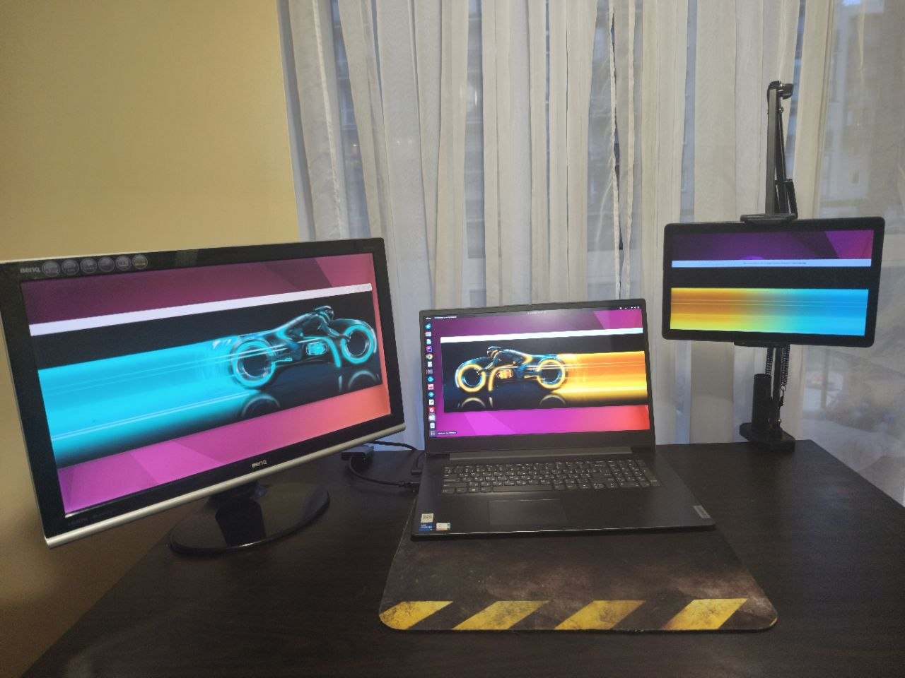
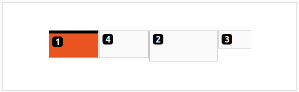
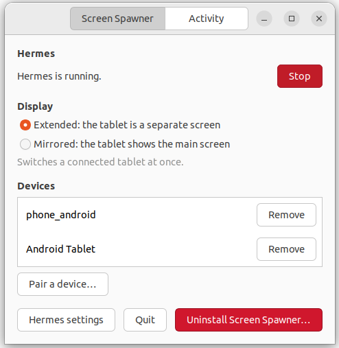
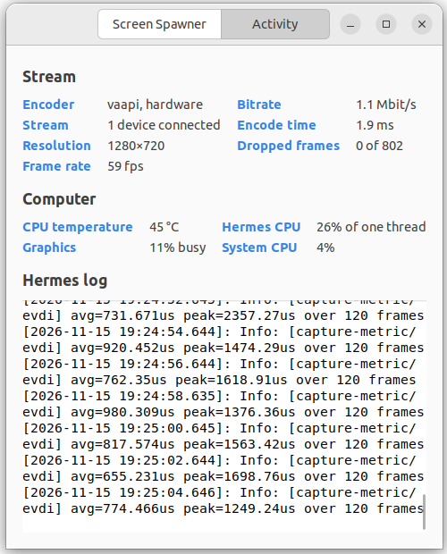

# Screen Spawner

**Screen Spawner** turns an **Android** tablet or phone into a wireless second or third monitor for **Linux** through the standard **Moonlight** app, alongside your physical monitors. It works over your home Wi-Fi network; no internet connection is needed once it is installed.

Use an Android tablet as an extra screen for Linux, a phone as a portable display for your laptop, or a tablet as a third monitor next to an HDMI one. No USB cable, no HDMI dummy plug, and no dedicated app on the tablet beyond Moonlight. The tablet becomes an extended display or a mirror of your screen, with touch input, and the system sees it as a real monitor.

**Tested configurations (current release):** GNOME on X11 and Wayland; Ubuntu, Linux Mint, and Debian. The installer also supports Fedora 45 and Arch Linux.



*From left: HDMI monitor, laptop screen, and an Android tablet as the third display.*



*GNOME Settings → Displays with four displays: the laptop, the HDMI monitor, a tablet and a phone. GNOME sees each device as a regular monitor: it can be moved, mirrored or made primary like the others.*

It is built on **Hermes + Moonlight**: Hermes runs on the laptop, creates the virtual monitor and streams it, and Moonlight on the tablet shows it and sends touch, mouse and keyboard input back.

The tablet works either as an **extended display**, a separate monitor with its own workspace, or as a **mirrored display**, a copy of the laptop screen. It works at the same time as a physical external monitor connected to the laptop: the tablet is simply one more display. You don't need cables, special hardware, or a purpose-built app on the tablet.

> **Current status:** works with one Android tablet running Moonlight. The tablet is a second monitor, extended or mirrored, with mouse, keyboard and touch, no noticeable latency, and no desktop freezes in a three-hour session. It can be used together with additional physical monitors. Artemis, phones and smart TVs have not been tested.

### Tested on

Ubuntu 22.04 with GNOME, on X11 and on Wayland. The installer was also tested on clean Ubuntu 22.04, 24.04 and 26.04, Linux Mint 22.2, Debian 13, Fedora 45 and Arch Linux.

## Goal

Turning a tablet into a real second monitor is a solved problem on Windows and macOS, but on Linux it is harder: a separate monitor the system treats as real, hardware video encoding and touch input on the tablet. The available options usually only mirror the existing screen, need a USB cable, a dedicated app on the tablet or a dummy HDMI plug, or encode the picture on the CPU.

What Screen Spawner does differently:

* **wireless**: the tablet connects over the home Wi-Fi network, no cable;
* **no app of its own on the tablet**: it uses Moonlight, available from Google Play;
* **GNOME on X11 and Wayland**, with the tablet as a separate screen or a mirror;
* **together with physical monitors**: laptop screen, HDMI monitor and tablet side by side, rearranged during a session;
* **hardware video encoding** on the GPU (VAAPI);
* **one script to install, one to uninstall**, removing exactly what was installed.

It installs and configures the tools below together and fixes what stopped them from working together. The long-term goal is any number of devices (tablets, phones, smart TVs), each either extended or mirrored.

---

## How it works

The picture travels the way game streaming does:

```text
Ubuntu laptop
  applications
       ↓
  EVDI virtual monitor     the system sees it as a second monitor
       ↓
  Hermes                   captures the monitor
       ↓
  Intel VAAPI              encodes it to H.264 / HEVC in hardware
       ↓
  ─── local network ───
       ↓
Android tablet
  Moonlight                receives the stream
       ↓
  hardware decoder
       ↓
  tablet screen
```

Touches, mouse and keyboard input on the tablet travel back the same way.

| Component | Role |
|-----------|------|
| [EVDI](https://github.com/DisplayLink/evdi) | Linux kernel module that creates virtual displays the OS treats as real monitors |
| [Hermes](https://github.com/MrOz59/Hermes) | Streaming server, a Linux port of Apollo, which is a fork of [Sunshine](https://github.com/LizardByte/Sunshine). It creates the virtual display, captures it and streams it |
| Intel VAAPI | Hardware H.264 / HEVC encoding, so the CPU stays free |
| [Moonlight](https://moonlight-stream.org/) / [Artemis](https://github.com/ClassicOldSong/moonlight-android) | Client on the device. It decodes the video in hardware |

Unlike ordinary remote desktop, the tablet is not limited to a copy of the existing screen: as an extended display, applications can be moved to it like to any other monitor. And unlike sending raw frames, only a compressed video stream crosses the network, and it never leaves your local network.

---

## Requirements

* **Ubuntu, Linux Mint, Debian, Fedora or Arch Linux:** the installer was tested on Ubuntu 22.04, 24.04 and 26.04, Linux Mint 22.2, Debian 13, Fedora 45 and Arch Linux. Streaming with the tablet was tested on Ubuntu 22.04 with GNOME (X11 and Wayland) and an Intel GPU. Hermes itself also supports other desktops and GPUs, but this setup has not been tried with them. The scripts install only the Intel VAAPI driver and build Hermes without CUDA, so NVIDIA GPUs get no hardware encoding from it
* An Android tablet with Moonlight, on the same home network as the laptop, over Wi-Fi. 5 GHz Wi-Fi works best, and Ethernet for the laptop even better. No internet connection is needed for streaming
* An internet connection during installation only: `install.sh` downloads packages (and the Hermes source code when building from source)

---

## Installation

```bash
git clone https://github.com/itkawa/screen-spawner
cd screen-spawner
./install.sh
```

Version 0.1.0 builds Hermes from source and can take 30–60 minutes.
For installation from prebuilt packages, use **0.1.1 or newer**.

The script downloads a prebuilt, patched Hermes package from the separate [screen-spawner-hermes-builds repository](https://github.com/itkawa/screen-spawner-hermes-builds) (release **v0.2.0** for Ubuntu, Mint and Debian, **v0.2.1** for Fedora and Arch Linux),
checks its SHA256 against the checksum pinned in `install.sh`, configures EVDI
to load at boot, and installs the **Screen Spawner** app with its launcher in the
application menu (see [Usage](#usage)). A **Hermes** launcher is added as well, for
running Hermes without the app.
Packages are available for amd64 Ubuntu 22.04, 24.04 and 26.04, Linux Mint 22.x
(the Ubuntu 24.04 package), Debian 13, Fedora 45 and Arch Linux. Installation
normally takes a few minutes; the first EVDI kernel module build can take longer.

**On Fedora**, EVDI comes from the [negativo17](https://negativo17.org) Multimedia
repository: the installer adds it limited to its two EVDI packages (`dkms-evdi`
and `libevdi`), so it never replaces anything else.
**On Arch Linux**, EVDI is in the AUR only: the installer builds the `evdi-dkms`
package with `makepkg`, as an AUR helper would. Upgrade the system first
(`sudo pacman -Syu`, and restart if the kernel was updated): the installer
does not upgrade it, and the Hermes package is built for the current Arch Linux.

On Ubuntu, Mint and Debian, if there is no matching package, the download fails or its checksum does not
match, the script falls back to building Hermes in `~/Apollo-Linux` from the
verified revision with `patches/evdi-fix.patch`. To request that explicitly:

```bash
./install.sh --build-from-source
```

If a verified package cannot be installed, the installer asks `Continue with the source build? [Y/n]:` and warns that building may take about an hour. Press Enter or answer `y` to build; answer `n` to stop. `--build-from-source` requests the build directly without this question.

A source build can take 30–60 minutes. It uses one job by default to limit
memory use. On a machine with enough RAM, use:

```bash
BUILD_JOBS=4 ./install.sh --build-from-source
```

The app goes to `~/.local/share/screen-spawner`, together with a copy of this README. It needs Python with GTK 3 and the AyatanaAppIndicator library for its top bar icon; the installer adds them if they are missing. On plain GNOME, as on Debian, it also adds the AppIndicator extension for GNOME Shell; log out and in once after the installation to see the icon.

### What it changes on your system

Screen Spawner does not change the Linux kernel. For the virtual monitor it relies on EVDI, the DisplayLink driver:

* It installs `evdi-dkms` from your distribution's repositories (on Fedora `dkms-evdi` from negativo17, on Arch Linux built from the AUR), and the kernel headers it needs. DKMS builds EVDI as a separate module (`evdi.ko`) for each installed kernel and builds it again after a kernel update. It is loaded and unloaded like any other driver.
* It writes `options evdi initial_device_count=4` to `/etc/modprobe.d/evdi.conf`, so the driver creates four devices at boot, one for each tablet or phone that can connect at the same time, and adds `evdi` to `/etc/modules` (on Fedora and Arch Linux, to `/etc/modules-load.d/screen-spawner-evdi.conf`), so the driver loads at boot. On Fedora it also adds `/etc/yum.repos.d/screen-spawner-evdi.repo` and the repository's signing key. **Devices at once** in the app changes the number; it takes effect after a restart. Unused devices cost nothing.

When EVDI loads, the kernel log says `evdi: module verification failed: signature and/or required key missing - tainting kernel`. That is normal for any driver DKMS builds on your computer instead of your distribution signing it: the kernel only notes that a module without its signature is loaded. Nothing is changed or broken by it. With Secure Boot on, the module has to be signed with a key enrolled in the firmware; Ubuntu offers to enroll one while it installs `evdi-dkms`.

Everything else is ordinary software: the Hermes package and its dependencies, and the app in your home folder. `uninstall.sh` removes what the installer added, except the kernel headers and your Hermes settings; see below.

If a kernel update ever leaves EVDI unbuilt, only the tablet stops connecting. The computer starts and works as usual, because your screens are driven by the graphics card's own driver. See [EVDI is missing](#evdi-is-missing).

### Uninstall

```bash
./uninstall.sh
```

or **Uninstall Screen Spawner…** in the app. A running app is closed first, which also stops Hermes.

The prebuilt package and its new dependencies are recorded too. `install.sh` records every change it makes in `~/.local/state/screen-spawner/installed.list`, and `uninstall.sh` removes only those. It lists them and asks before removing anything. Anything that was there before the installation stays. Node.js 22 and NVM are kept if you have since installed your own global npm packages or other Node.js versions. `~/Apollo-Linux` is kept if it contains your own changes.

Essential/protected system packages and their dependencies are always kept, even if a dependency transaction added them during installation. The kernel headers (other kernel modules may need them) and the Hermes settings and pairings in `~/.config/hermes` intentionally stay after either installation path. A source build can also update system libraries through the GCC 13 repository; the uninstaller keeps those updates because rolling them back could break the system.

---

## Usage

Everything is done in the **Screen Spawner** app. Open it from the application menu. It has a window with two tabs, **Screen Spawner** and **Activity**, and an icon in the top bar.



### Start and stop Hermes

Press the green **Start** button. Hermes needs a few seconds; then the status reads *Hermes is running* and the button turns into a red **Stop**.

Hermes runs only while the app runs:

* closing the window with its × button only hides it; the app stays in the top bar, like Telegram, and Hermes keeps streaming;
* **Quit**, in the window or in the top bar menu, stops Hermes and closes the app;
* if the app itself ends unexpectedly, Hermes is stopped with it.

The first time, Hermes asks for a Web UI account: if the status says so, press **Hermes settings** and create a user name and password in the page that opens. The app itself does not need them.

Hermes does not start with the system, on purpose: it runs only when you start it, so it does not keep the graphics card busy and is not reachable on the network while you don't use the tablet. After a reboot, open the app and press **Start**.

To have the app ready after logging in, tick **Open Screen Spawner at login, in the top bar** under **At login** in its window. The app then opens in the top bar without its window, and Hermes waits for **Start**. To have Hermes running right away as well, also tick **Start Hermes too**. Untick them to stop. Uninstalling removes these settings too.

### Pair a tablet or phone (once per device)

1. On the tablet, install Moonlight and add the laptop. Moonlight usually finds it on the local network by itself; otherwise add it by IP address.
2. In Moonlight, tap the laptop. Moonlight shows a 4-digit PIN.
3. In the app, press **Pair a device…** (it is available while Hermes runs), enter the PIN and a name for the device, such as *Tablet* or *Phone*, and press **Pair**.
4. The app waits until Moonlight finishes pairing and gives the device the permissions it needs: starting the desktop, watching the stream, and touch, pen, mouse, keyboard and controller input.

Paired devices are listed under **Devices**. **Remove** unpairs one; it then needs a new PIN to connect.

A phone with Moonlight works as a second monitor the same way as a tablet. Moonlight streams in 16:9, so a phone with a longer screen shows black bars at the sides.

### Connect

In Moonlight, open the laptop and choose **Desktop**. Hermes creates the virtual monitor at that moment, and the tablet shows it. The virtual monitor does not exist before a client connects.

### Extended or mirrored

Under **Display** choose:

* **Extended**: the tablet is a separate screen beside the laptop, and windows can be moved onto it;
* **Mirrored**: the tablet shows the same picture as the laptop's main screen. Other monitors stay separate screens.

A connected tablet switches at once, without disconnecting. Otherwise the choice applies the next time it connects. The same switch is in the top bar menu.

While the tablet is connected, it can also be moved in **Settings → Displays** like any other monitor; touch and the cursor follow it without reconnecting.

### Activity: what is happening right now

The **Activity** tab shows, once a second:

* **Stream**: the encoder and whether it runs on the graphics hardware or the CPU, how many devices are connected, the resolution, frame rate, bitrate, encoding time per frame and dropped frames;
* **Computer**: the CPU temperature, how busy the graphics are and at what frequency, and how much CPU Hermes and the whole system use;
* **Hermes log**: the end of Hermes's log, as it is written.



Nothing is measured while the tab is not open or the window is hidden. Measured numbers for a typical laptop are in [docs/performance.md](docs/performance.md).

### Top bar menu

The icon in the top bar opens a menu: open the window, start or stop Hermes, switch between extended and mirrored, open the Hermes settings, and quit.

### Hermes settings

**Hermes settings** opens the Hermes Web UI at <https://localhost:47990> in the browser, for everything the app does not cover. Note that Hermes ends the current session when an app is saved on its **Applications** page, and restarts when settings are applied on its **Configuration** page: the tablet is disconnected and has to connect again.

### Uninstall from the app

**Uninstall Screen Spawner…** opens a terminal with the uninstaller. It lists what it will remove and asks before removing anything. See also [Uninstall](#uninstall).

### Without the app

Hermes can also be run and set up without the app, through the **Hermes** launcher and the Web UI:

* pair on the **PIN** page, then give the device **Launch Apps**, **View Streams**, **List Apps**, **Touch Input**, **Mouse Input** and **Keyboard Input** in the list of paired devices below it; without **Launch Apps** Moonlight disconnects as soon as **Desktop** is chosen;
* on the **Applications** page, edit **Desktop**: turn on **Always create Virtual Display** and choose **Virtual Display Layout**, **Extend** or **Mirror**. With **Always create Virtual Display** off, Hermes streams the laptop's main screen itself, without a virtual monitor.

### Mouse, keyboard and touch

The tablet works alongside the laptop's own input devices, the way a touchpad and a USB mouse do on a laptop: they share one cursor and one keyboard focus.

A touch moves the cursor straight to the touched point on the tablet, also after the monitors are rearranged during the session.

### Sound

The tablet's speakers are not used. All sound, including from windows on the tablet, plays through the computer's own output: the laptop speakers, headphones, or whatever is selected in the system sound settings.

`install.sh` sets this with the line `stream_audio = false` in `~/.config/hermes/hermes.conf`. Without it, Hermes sends the whole system's sound to the tablet while it is connected, and the laptop goes silent. To get that behaviour, remove the line and restart Hermes.

---

## What has been tested

With Moonlight on one Android tablet, on Ubuntu 22.04 with GNOME on X11:

* the tablet works as an extended monitor and as a mirrored one;
* the tablet can be moved in the display settings during a session, and touch input follows it;
* it works at the same time as a physical HDMI monitor: laptop screen, HDMI monitor and tablet are three displays side by side;
* mouse, keyboard and touch input reach the tablet's display;
* there was no noticeable latency in use. The latency has not been measured with instruments;
* a three-hour session with video playing ran without a single desktop freeze;
* an Android phone with Moonlight works as a second monitor too: picture, touch, mouse, and rearranging the monitors;
* over **2.4 GHz Wi-Fi**, with the laptop and the tablet on the same network and about 20 other networks nearby, a fullscreen video played on the tablet (720p, extended display) for a minute, and no stutter was noticed. Hermes dropped no frames, and pings to the tablet lost nothing and mostly stayed under 20 ms, with rare spikes to about 50 ms. The same test on **5 GHz Wi-Fi** gave pings of 2–11 ms, without the occasional network delays of 20–50 ms seen on 2.4 GHz; no stutter was noticed on either. Mirrored mode, with the video fullscreen on the laptop and shown on the tablet, was checked the same way on both: no dropped frames and no stutter noticed. On a busy 2.4 GHz network short stutters are still possible, so 5 GHz Wi-Fi works best. The load on the computer and all the numbers are in [docs/performance.md](docs/performance.md).

On GNOME on Wayland, in shorter sessions: extended and mirrored, touch input, and moving the tablet during a session.

The installation and uninstallation were tested end to end on clean Ubuntu 22.04, 24.04 and 26.04, Linux Mint 22.2, Debian 13, Fedora 45 and Arch Linux systems in a container, including a real DKMS build of EVDI. A container has no desktop, so streaming was not tried there.

---

## Known issues

* **The virtual monitor stays after you quit Moonlight.** Hermes only pauses the session, so the monitor remains in the display settings, and windows on it stay out of sight until you reconnect or stop Hermes.
* **A VPN on the tablet can block the connection.** Turn it off if Moonlight cannot find or reach the laptop.

---

## Roadmap

Release history is in [CHANGELOG.md](CHANGELOG.md). Planned next for the Screen Spawner app:

* disconnect the tablet from the app, which also removes its virtual monitor;
* a scale for the tablet alone in extended mode (100%, 125%, 150%…), so text and windows on it can be made larger while the laptop stays as it is;
* mirroring at a lower resolution on both screens, so that everything on the tablet is larger;
* sound by screen: sound of a window on the tablet plays on the tablet, the rest on the computer;
* choose which display is 1, 2 and 3, the way it works for physical monitors.

---

## Upstream contributions

Fixes I find while building Screen Spawner go to Hermes itself, so everyone who uses Hermes with EVDI gets them, not only Screen Spawner.

### Merged

* **[MrOz59/Hermes#117](https://github.com/MrOz59/Hermes/pull/117): an EVDI virtual display no longer freezes the desktop.** With EVDI on GNOME under X11, the whole desktop froze for seconds at a time, with `flip_done timed out` in the kernel log. I traced it to the EVDI event loop in Hermes: when the driver already had a frame waiting, `evdi_request_update()` returned true and sent no event for it, but Hermes ignored that answer and waited for an event, so the frame was never grabbed and its page flip never completed. Hermes now grabs such a frame at once and no longer repeats a request the driver is still answering, which also removes hundreds of `Update was already requested` kernel warnings a second. Merged on 12 November 2026; Hermes nightly builds include it since 0.7.0+49a0b43.

  While the pull request was being checked, I also found why its CI failed: the newest Arch Linux ships OpenSSL 4.1, and Hermes no longer compiled against it. The maintainer fixed that in [#118](https://github.com/MrOz59/Hermes/pull/118).

* **[MrOz59/Hermes#123](https://github.com/MrOz59/Hermes/pull/123): Hermes finds the connector of an EVDI virtual display.** Hermes looked for the `evdi` driver under the connector's own sysfs entry, which has none, so it never found the virtual monitor's connector and could not activate it. It now reads the driver from the card's device. The maintainer carried it onto the current main in [#128](https://github.com/MrOz59/Hermes/pull/128) together with a CI fix; merged on 15 November 2026.

* **[MrOz59/Hermes#132](https://github.com/MrOz59/Hermes/pull/132): Hermes no longer encodes an unchanged EVDI picture again and again.** The capture loop copied the virtual display and sent it as a new frame on every tick, even when nothing on it had changed, so on an idle desktop the encoder kept working at almost the full frame rate. Hermes now sends a new frame only when the picture changes, and otherwise repeats the last one at its minimum rate. On an idle desktop it encodes 18 instead of 53 frames a second and uses 9% of one CPU thread instead of 22%; with a video playing, about half the load it had before. The mouse in mirrored mode no longer lags. Merged on 16 November 2026.

* **[MrOz59/Hermes#136](https://github.com/MrOz59/Hermes/pull/136): Hermes no longer crashes when you quit it from its Web UI.** After Quit, Hermes answered the browser from a separate thread 5 s later. When shutting down took longer, as closing an EVDI virtual display does on GNOME under Wayland, that thread used the already destroyed web server and Hermes crashed on the way out. The thread now lets go of the answer before the server stops. Merged on 17 November 2026.

* **[MrOz59/Hermes#140](https://github.com/MrOz59/Hermes/pull/140): Hermes finds the right EVDI card when there is more than one.** libevdi numbers EVDI devices by their DRM card, but Hermes looked the same number up as a different kind of device, which can be another card. With a second EVDI device, such as a DisplayLink dock, Hermes connected the virtual display on one card and waited for it on the other, and Moonlight got error 503. In the same pull request I added the changelog entries I had forgotten for #132 and #136. Merged on 18 November 2026.

### Next

The rest of `patches/evdi-fix.patch` is planned to go to Hermes the same way: mirroring at different resolutions, and touch input on GNOME under X11. Once Hermes includes them, Screen Spawner can install the official Hermes packages instead of its own builds.

---

## Troubleshooting

### The prebuilt package does not work

Run `sunshine --version` in a terminal and keep the error message. To use a
source build instead:

```bash
./uninstall.sh
./install.sh --build-from-source
```

The uninstaller preserves `~/.config/hermes`, including device pairings.
The package is named `hermes-screen-spawner` and conflicts with official
`hermes` packages: remove the other installation before switching between them.
The build scripts and exact source revision are in [packaging/](packaging/).


### Hermes does not start

Start it from a terminal and look at the errors:

```bash
/usr/bin/sunshine
```

Messages such as `Failed to gain CAP_SYS_ADMIN` or `Couldn't get handle for DRM Framebuffer` are expected in this setup and do not mean anything is broken. What matters is:

```text
EVDI available - real virtual displays supported!
Linux virtual display driver initialized successfully.
Found H.264 encoder: h264_vaapi [vaapi]
```

### EVDI is missing

```bash
lsmod | grep evdi
```

If nothing appears:

```bash
sudo modprobe evdi
```

If it says the module is not found, EVDI was not built for the kernel you are running, usually right after a kernel update. Build it with:

```bash
sudo dkms autoinstall
```

`dkms status` lists the kernels EVDI is built for. Until it builds, you can start the previous kernel from the boot menu (the **Advanced options** entry).

### No virtual monitor appears

The virtual monitor exists only while a client is connected, and only if **Always create Virtual Display** is on for the Desktop app (see [Set up the Desktop app](#set-up-the-desktop-app-once)). With Moonlight connected, check:

```bash
xrandr --listmonitors
cat /sys/devices/evdi/count
```

### No hardware encoder

```bash
vainfo
dpkg -l | grep intel-media-va-driver
```

`vainfo` should list H.264 and HEVC encoding profiles, and Hermes should report `h264_vaapi` at startup.

On Debian, hardware encoding on newer Intel GPUs may need the `intel-media-va-driver-non-free` package from the `non-free` repository instead of `intel-media-va-driver`.

---

## Repository contents

| File | Purpose |
|------|---------|
| `install.sh` | Installs the dependencies, EVDI and Hermes |
| `app/` | The Screen Spawner app: window, top bar icon, icons |
| `uninstall.sh` | Removes what `install.sh` installed |
| `CHANGELOG.md` | Release history and planned changes |
| `packaging/` | Docker builds and CPack packaging for modified Hermes |
| `docs/app-main.png`, `docs/app-activity.png` | Screenshots of the app |
| `docs/performance.md` | Load and stream measurements, in extended and mirrored mode, over 2.4 and 5 GHz Wi-Fi |
| `tools/measure-load.py` | The script that took those measurements |
| `patches/evdi-fix.patch` | Fixes for Hermes: desktop freezes with EVDI, input on X11, mirroring and moving the tablet on X11 and Wayland, libevdi 1.12 on Ubuntu 22.04 |
| `patches/openssl4.patch` | Hermes [#118](https://github.com/MrOz59/Hermes/pull/118): building with OpenSSL 4, for the Fedora and Arch Linux packages |

---

## Author

Developed by [itkawa](https://github.com/itkawa).

Bug reports and suggestions are welcome via [GitHub Issues](https://github.com/itkawa/screen-spawner/issues).

---

## License

Copyright (C) 2026 itkawa

This project is licensed under the **GNU General Public License v3.0**. See [LICENSE](LICENSE) for the full text.

You may use, modify, and redistribute it. Any distributed modified version must also be released under GPL-3.0.

`patches/evdi-fix.patch` changes the source code of Hermes and is licensed under GPL-3.0, like Hermes itself.

This repository contains no third-party code other than that patch. The main components are separate projects with their own licenses, obtained from their own sources:

| Component | License |
|-----------|---------|
| Hermes, Apollo, Sunshine | GPL-3.0-only |
| shared-web (Hermes Web UI dependency) | AGPL-3.0-only |
| EVDI kernel module | GPL-2.0 |
| EVDI library (libevdi) | LGPL-2.1 |
| Moonlight, Artemis (installed on the device) | GPL-3.0 |
| NVM | MIT |

If you distribute a built copy of Hermes with this patch, GPL-3.0 requires you to provide its source code, including the patch, and to state that it was modified.

The prebuilt Hermes release also provides a complete corresponding-source
archive, including dependency sources, exact component revisions, original
licenses and build scripts. The Web UI links directly to that archive.
See [third-party notices](packaging/THIRD-PARTY-NOTICES.md) and the release's
**Release contents** section for the exact files being distributed.
