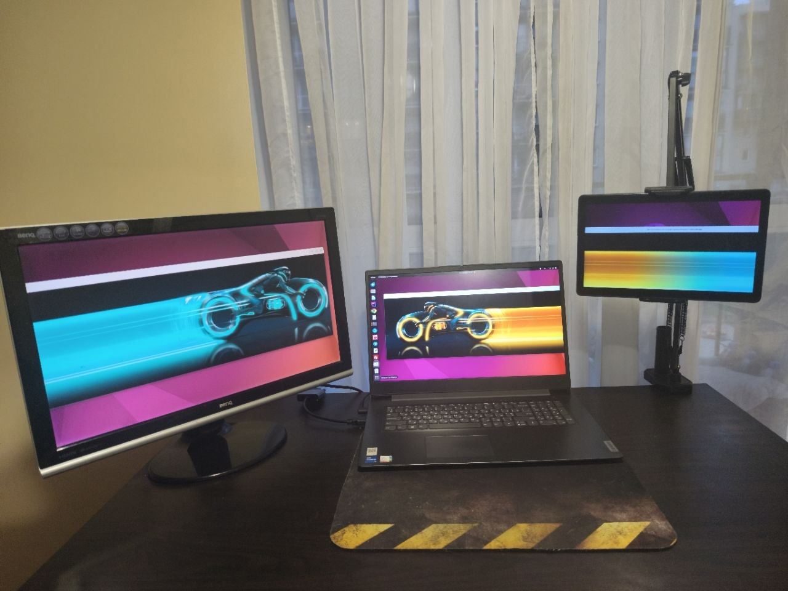

# Screen Spawner

**Screen Spawner** turns an **Android** tablet into a wireless second monitor for **Linux** on GNOME, through the standard **Moonlight** app, alongside your physical monitors. It works over your home Wi-Fi network; no internet connection is needed once it is installed.



*From left: HDMI monitor, laptop screen, and an Android tablet as the third display.*

It is built on **Hermes + Moonlight**: Hermes runs on the laptop, creates the virtual monitor and streams it, and Moonlight on the tablet shows it and sends touch, mouse and keyboard input back.

The tablet works either as an **extended display**, a separate monitor with its own workspace, or as a **mirrored display**, a copy of the laptop screen. It works at the same time as a physical external monitor connected to the laptop: the tablet is simply one more display. You don't need cables, special hardware, or a purpose-built app on the tablet.

> **Current status:** works with one Android tablet running Moonlight. The tablet is a second monitor, extended or mirrored, with mouse, keyboard and touch, no noticeable latency, and no desktop freezes in a three-hour session. It can be used together with additional physical monitors. Artemis, phones and smart TVs have not been tested.

### Tested on

Ubuntu 22.04 with GNOME, on X11 and on Wayland. The installer was also tested on clean Ubuntu 22.04, 24.04 and 26.04, Linux Mint 22.2 and Debian 13.

## Goal

Turning a tablet into a real second monitor is a solved problem on Windows and macOS, but on Linux it is harder: a separate monitor the system treats as real, hardware video encoding and touch input on the tablet. The available options usually only mirror the existing screen, need a USB cable, a dedicated app on the tablet or a dummy HDMI plug, or encode the picture on the CPU.

What Screen Spawner does differently:

* **wireless**: the tablet connects over the home Wi-Fi network, no cable;
* **no app of its own on the tablet**: it uses Moonlight, available from Google Play;
* **GNOME on X11 and Wayland**, with the tablet as a separate screen or a mirror;
* **together with physical monitors**: laptop screen, HDMI monitor and tablet side by side, rearranged during a session;
* **hardware video encoding** on the GPU (VAAPI);
* **one script to install, one to uninstall**, removing exactly what was installed.

It installs and configures the tools below together and fixes what stopped them from working together. The long-term goal is any number of devices (tablets, phones, smart TVs), each either extended or mirrored.

---

## How it works

The picture travels the way game streaming does:

```text
Ubuntu laptop
  applications
       ↓
  EVDI virtual monitor     the system sees it as a second monitor
       ↓
  Hermes                   captures the monitor
       ↓
  Intel VAAPI              encodes it to H.264 / HEVC in hardware
       ↓
  ─── local network ───
       ↓
Android tablet
  Moonlight                receives the stream
       ↓
  hardware decoder
       ↓
  tablet screen
```

Touches, mouse and keyboard input on the tablet travel back the same way.

| Component | Role |
|-----------|------|
| [EVDI](https://github.com/DisplayLink/evdi) | Linux kernel module that creates virtual displays the OS treats as real monitors |
| [Hermes](https://github.com/MrOz59/Hermes) | Streaming server, a Linux port of Apollo, which is a fork of [Sunshine](https://github.com/LizardByte/Sunshine). It creates the virtual display, captures it and streams it |
| Intel VAAPI | Hardware H.264 / HEVC encoding, so the CPU stays free |
| [Moonlight](https://moonlight-stream.org/) / [Artemis](https://github.com/ClassicOldSong/moonlight-android) | Client on the device. It decodes the video in hardware |

Unlike ordinary remote desktop, the tablet is not limited to a copy of the existing screen: as an extended display, applications can be moved to it like to any other monitor. And unlike sending raw frames, only a compressed video stream crosses the network, and it never leaves your local network.

---

## Requirements

* **A distribution with apt:** the installer was tested on Ubuntu 22.04, 24.04 and 26.04, Linux Mint 22.2 and Debian 13. Streaming with the tablet was tested on Ubuntu 22.04 with GNOME (X11 and Wayland) and an Intel GPU. Hermes itself also supports other desktops and GPUs, but this setup has not been tried with them. The scripts install only the Intel VAAPI driver and build Hermes without CUDA, so NVIDIA GPUs get no hardware encoding from it
* An Android tablet with Moonlight, on the same home network as the laptop, over Wi-Fi. 5 GHz Wi-Fi works best, and Ethernet for the laptop even better. No internet connection is needed for streaming
* An internet connection during installation only: `install.sh` downloads packages and the Hermes source code

---

## Installation

```bash
git clone https://github.com/itkawa/screen-spawner
cd screen-spawner
./install.sh
```

The script installs the dependencies, configures EVDI to load at boot, builds Hermes in `~/Apollo-Linux` from a tested commit with the fixes from `patches/evdi-fix.patch`, and adds a **Hermes** launcher to the application menu.

The build uses a single job by default, because parallel compilation can run out of memory on laptops, and it takes a long time. To build faster:

```bash
BUILD_JOBS=4 ./install.sh
```

### Uninstall

```bash
./uninstall.sh
```

`install.sh` records every change it makes in `~/.local/state/screen-spawner/installed.list`, and `uninstall.sh` removes only those. It lists them and asks before removing anything. Anything that was there before the installation stays. Node.js 22 and NVM are kept if you have since installed your own global npm packages or other Node.js versions. `~/Apollo-Linux` is kept if it contains your own changes.

A few things intentionally stay after uninstalling: the kernel headers (other kernel modules may need them), the system libraries updated by the GCC 13 repository (rolling them back would break the system), and the Hermes settings and pairings in `~/.config/hermes`, which you can delete by hand.

---

## Usage

### Start Hermes

Start **Hermes** from the application menu, or from a terminal:

```bash
cd ~/Apollo-Linux
./build/sunshine
```

The launcher opens a terminal window on purpose, so startup errors stay visible. To stop Hermes, press `Ctrl+C` in that window.

Hermes has to be started again after every reboot.

### Pair the tablet (once)

1. On the laptop, open the Hermes Web UI at <https://localhost:47990> and complete the initial setup.
2. On the tablet, install Moonlight and add the laptop. Moonlight usually finds it on the local network by itself; otherwise add it by IP address.
3. Moonlight shows a PIN. Enter it in the Hermes Web UI.

### Set up the Desktop app (once)

Out of the box, the **Desktop** app does not create a virtual monitor, and the tablet just shows the laptop screen. To turn it on, open **Applications** in the Hermes Web UI, click **Edit** on **Desktop**, then:

- turn on **Always create Virtual Display**;
- set **Virtual Display Layout**:
  - **Extend**: the tablet is a separate screen beside the laptop;
  - **Mirror**: the tablet shows the same picture as the laptop's main screen, at that screen's resolution. Other monitors stay separate screens.

Save. The setting applies from the next connection.

There are two ways to mirror:

- **Mirror** as above: the tablet is a virtual monitor that shows a copy of the main screen. The mode can be switched between Extend and Mirror at any time.
- **Always create Virtual Display** turned off: Hermes streams the laptop's main screen itself, without a virtual monitor. Nothing changes in the display settings.

While the tablet is connected, it can be moved in **Settings → Displays** like any other monitor; touch and the cursor follow it without reconnecting.

### Connect

In Moonlight, open the laptop and choose **Desktop**. Hermes creates the virtual monitor at that moment, and the tablet shows it. The virtual monitor does not exist before a client connects.

### Mouse, keyboard and touch

The tablet works alongside the laptop's own input devices, the way a touchpad and a USB mouse do on a laptop: they share one cursor and one keyboard focus.

A touch moves the cursor straight to the touched point on the tablet, also after the monitors are rearranged during the session.

### Sound

The tablet's speakers are not used. All sound, including from windows on the tablet, plays through the computer's own output: the laptop speakers, headphones, or whatever is selected in the system sound settings.

`install.sh` sets this with the line `stream_audio = false` in `~/.config/hermes/hermes.conf`. Without it, Hermes sends the whole system's sound to the tablet while it is connected, and the laptop goes silent. To get that behaviour, remove the line and restart Hermes.

---

## What has been tested

With Moonlight on one Android tablet, on Ubuntu 22.04 with GNOME on X11:

* the tablet works as an extended monitor and as a mirrored one;
* the tablet can be moved in the display settings during a session, and touch input follows it;
* it works at the same time as a physical HDMI monitor: laptop screen, HDMI monitor and tablet are three displays side by side;
* mouse, keyboard and touch input reach the tablet's display;
* there was no noticeable latency in use. The latency has not been measured with instruments;
* a three-hour session with video playing ran without a single desktop freeze.

On GNOME on Wayland, in shorter sessions: extended and mirrored, touch input, and moving the tablet during a session.

The installation and uninstallation were tested end to end on clean Ubuntu 22.04, 24.04 and 26.04, Linux Mint 22.2 and Debian 13 systems in a container. A container has no desktop, so streaming was not tried there.

---

## Known issues

* **The virtual monitor stays after you quit Moonlight.** Hermes only pauses the session, so the monitor remains in the display settings, and windows on it stay out of sight until you reconnect or stop Hermes.
* **A VPN on the tablet can block the connection.** Turn it off if Moonlight cannot find or reach the laptop.
* **No autostart.** Hermes has to be started by hand after every reboot.

---

## Roadmap

Version 0.1.0 has no app of its own: Hermes is started from the application menu and set up in its Web UI, as described above. Release history is in [CHANGELOG.md](CHANGELOG.md).

Planned for a later version is an optional **Screen Spawner** app in the top bar, so that Hermes and the tablet can be set up without the Web UI. Installing it will be optional, and the Web UI way will keep working. The app would:

* start and stop Hermes, start it at login;
* pair a new tablet by typing its PIN;
* disconnect the tablet, which also removes its virtual monitor;
* switch between modes at any time, without reconnecting:
  * **extended**, with a scale for the tablet alone (100%, 125%, 150%…), so text and windows on it can be made larger while the laptop stays as it is;
  * **mirrored**, either at the laptop's resolution (sharp, but small on a smaller tablet screen) or at a lower resolution on both screens, so that everything on the tablet is larger;
* choose which display is 1, 2 and 3, the way it works for physical monitors.

---

## Troubleshooting

### Hermes does not start

Start it from a terminal and look at the errors:

```bash
cd ~/Apollo-Linux
./build/sunshine
```

Messages such as `Failed to gain CAP_SYS_ADMIN` or `Couldn't get handle for DRM Framebuffer` are expected in this setup and do not mean anything is broken. What matters is:

```text
EVDI available - real virtual displays supported!
Linux virtual display driver initialized successfully.
Found H.264 encoder: h264_vaapi [vaapi]
```

### EVDI is missing

```bash
lsmod | grep evdi
```

If nothing appears:

```bash
sudo modprobe evdi
```

### No virtual monitor appears

The virtual monitor exists only while a client is connected, and only if **Always create Virtual Display** is on for the Desktop app (see [Set up the Desktop app](#set-up-the-desktop-app-once)). With Moonlight connected, check:

```bash
xrandr --listmonitors
cat /sys/devices/evdi/count
```

### No hardware encoder

```bash
vainfo
dpkg -l | grep intel-media-va-driver
```

`vainfo` should list H.264 and HEVC encoding profiles, and Hermes should report `h264_vaapi` at startup.

On Debian, hardware encoding on newer Intel GPUs may need the `intel-media-va-driver-non-free` package from the `non-free` repository instead of `intel-media-va-driver`.

---

## Repository contents

| File | Purpose |
|------|---------|
| `install.sh` | Installs the dependencies, EVDI and Hermes |
| `uninstall.sh` | Removes what `install.sh` installed |
| `CHANGELOG.md` | Release history and planned changes |
| `patches/evdi-fix.patch` | Fixes for Hermes: desktop freezes with EVDI, input on X11, mirroring and moving the tablet on X11 and Wayland, libevdi 1.12 on Ubuntu 22.04 |

---

## Author

Developed by [itkawa](https://github.com/itkawa).

Bug reports and suggestions are welcome via [GitHub Issues](https://github.com/itkawa/screen-spawner/issues).

---

## License

Copyright (C) 2026 itkawa

This project is licensed under the **GNU General Public License v3.0**. See [LICENSE](LICENSE) for the full text.

You may use, modify, and redistribute it. Any distributed modified version must also be released under GPL-3.0.

`patches/evdi-fix.patch` changes the source code of Hermes and is licensed under GPL-3.0, like Hermes itself.

This repository contains no third-party code other than that patch. The main components are separate projects with their own licenses, obtained from their own sources:

| Component | License |
|-----------|---------|
| Hermes, Apollo, Sunshine | GPL-3.0 |
| EVDI kernel module | GPL-2.0 |
| EVDI library (libevdi) | LGPL-2.1 |
| Moonlight, Artemis (installed on the device) | GPL-3.0 |
| NVM | MIT |

If you distribute a built copy of Hermes with this patch, GPL-3.0 requires you to provide its source code, including the patch, and to state that it was modified.
