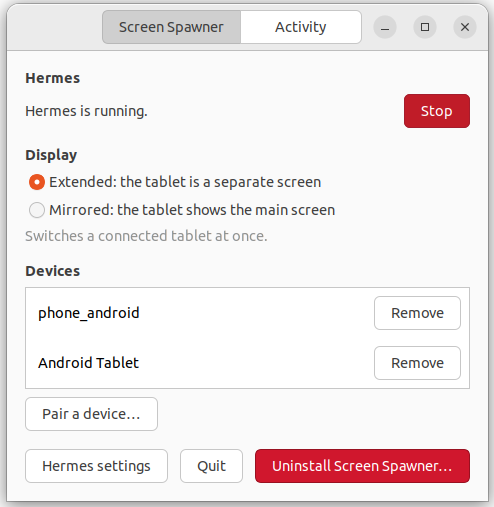

Title: Screen Spawner 0.3.0 — several tablets and phones at once, each with its own screen
Tag: v0.3.0

---

Connect a tablet and a phone (up to four devices) at the same time: each one gets a screen of its own on one shared desktop.



## What's new

- **A screen for each device.** Every tablet or phone connected with Moonlight gets its own monitor; windows move between them like between physical monitors.
- **Extended, Mirrored or Per device.** One mode for all devices, or a choice for each: its own screen, or a mirror of any of the computer's monitors. The app remembers each device's choice.
- **Devices at once.** Four by default; change it in the app (administrator password, applies after a restart).
- **Devices leave independently.** One device disconnecting no longer ends the others' sessions, and Moonlight no longer says the session was started on another device.
- **Safer start.** The app checks the EVDI driver first and explains what to do if a kernel update left it missing; it never starts a second Hermes; if GNOME refuses a new display layout, the previous one comes back.
- New icons.

## Fixed

- Returning to Moonlight after it was in the background failed with error 503.
- On X11, switching a device to a mirror took 4–5 s and the laptop screen blinked three times; it now takes about 0.2 s.
- On X11, a second device could not connect while GNOME was rearranging the displays: Hermes waited 22 s for an answer from GNOME. It now asks the X server.

## Installation

```bash
git clone https://github.com/itkawa/screen-spawner
cd screen-spawner
./install.sh
```

Updating from 0.2.0: run `git pull` in the `screen-spawner` folder, then `./install.sh`. Restart the computer once afterwards so that EVDI makes four virtual displays instead of one; your paired devices and Hermes settings are kept.

Hermes is the prebuilt, patched 0.5.1 package from the builds release v0.2.0, for amd64 Ubuntu 22.04, 24.04 and 26.04, Linux Mint 22.x and Debian 13. Its sources and the patch are linked from the [screen-spawner-hermes-builds](https://github.com/itkawa/screen-spawner-hermes-builds) release.

## Nuances

- On X11, the physical monitors go dark for a moment when a device connects or leaves: GNOME rebuilds the X screen. Wayland does not do this.
- All sound plays on the computer. Sound per device is planned for the next release, together with a choice of how a tablet's touches act.

## Upstream

Merged into Hermes since 0.2.0: two EVDI devices on different cards no longer fail with error 503 ([#140](https://github.com/MrOz59/Hermes/pull/140)). Earlier: [#117](https://github.com/MrOz59/Hermes/pull/117), [#123](https://github.com/MrOz59/Hermes/pull/123), [#132](https://github.com/MrOz59/Hermes/pull/132), [#136](https://github.com/MrOz59/Hermes/pull/136).
